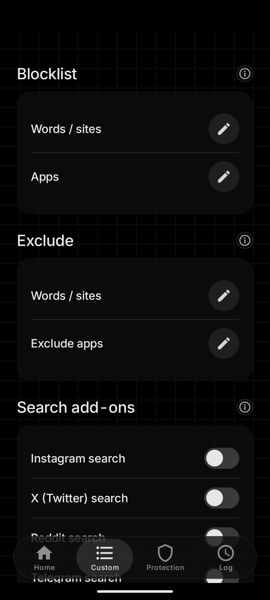

<div align="center">

<a href="https://github.com/Productivityguy/ownfate/blob/main/fastlane/metadata/android/en-US/images/icon.png"></a>

# OwnFate

[](https://github.com/Productivityguy/ownfate/releases/latest)
[](LICENSE)
[](#install)
[](#privacy)

**Offline porn and gambling blocking for Android. No VPN, no DNS, no network access, no analytics.**

`org.ownfate.app` · version 1.0.0 · API 26+

[](https://github.com/Productivityguy/ownfate/releases/latest)

</div>

## Screenshots

Click on any image to enlarge it.

| | | | |
| --- | --- | --- | --- |
| [](https://github.com/Productivityguy/ownfate/blob/main/fastlane/metadata/android/en-US/images/phoneScreenshots/1-home-dark.png) | [](https://github.com/Productivityguy/ownfate/blob/main/fastlane/metadata/android/en-US/images/phoneScreenshots/2-home-light.png) | [](https://github.com/Productivityguy/ownfate/blob/main/fastlane/metadata/android/en-US/images/phoneScreenshots/3-custom.png) | [](https://github.com/Productivityguy/ownfate/blob/main/fastlane/metadata/android/en-US/images/phoneScreenshots/4-protection.png) |

## Why OwnFate

| | |
| --- | --- |
| 🔒 **Private by design** | No `INTERNET` permission and no manifest permissions at all. Nothing the app reads can leave the phone. |
| 🧠 **On-device matching** | Screen text, typed text and address bars are folded and matched locally. Leetspeak, punctuation and Unicode lookalikes do not slip through. |
| ⚖️ **Fairer blocks** | Ambiguous words are SOFT and can be appealed. Explicit help searches such as “how to quit porn” win over the blockers. |
| 🌐 **Sites and apps** | 79,383 adult hosts, 6,862 gambling hosts, prediction-market hosts and curated app lists, bundled into the APK. |
| 🧩 **Custom where it counts** | Bring your own words, sites and apps. Exclusions are precise, and site/app blocks still apply when a word is allowed. |
| 🔐 **Change lock** | Delay or password-protect weaker changes. Stricter changes apply immediately; there is no recovery shortcut. |
| 🪶 **Lightweight** | No VPN, no DNS proxy, no analytics, no runtime dependencies, no permissions and a small APK. |

## How it works

1. Turn on the switches you need. Everything is off by default.
2. The accessibility service reads on-screen text, address bars and typed text locally, then matches it against bundled lists.
3. A block steps back out of the page and raises a full-screen card. It stays until **Close**, or **Appeal** on a soft word match.

A soft match is deliberately appealable. Hard words, custom words, websites and apps are not.

## What it blocks

| Area | Coverage |
| --- | --- |
| Adult websites | 79,383 bundled hosts, matched from the browser address bar |
| Gambling websites | 6,862 bundled hosts, matched from the browser address bar |
| Prediction markets | Bundled event-market hosts and apps |
| Adult words and names | Tiered word engine with a soft-word appeal |
| Gambling and prediction apps | Curated starter lists plus apps you pick yourself |
| Social search | Instagram, X, Reddit and Telegram search, all off by default |

## Install

1. Download the latest `ownfate-<version>.apk` from [GitHub Releases](https://github.com/Productivityguy/ownfate/releases/latest).
2. Open OwnFate and tap the accessibility card, or go to **Settings → Accessibility → OwnFate** and turn the service on.
3. Optionally add device admin from **Protection**. It only adds Android’s deactivation step before uninstall; no policies are declared.
4. Configure the switches, your own lists and the change lock.

On Android 13 and later, sideloaded apps may need **Settings → Apps → OwnFate → ⋮ → Allow restricted settings** before the accessibility service can be enabled.

> **Switching between GitHub and F-Droid?** They use different signing keys. Uninstall the other build first; local settings and streaks do not carry over.

## Privacy

- No `INTERNET` permission.
- No analytics, crash reporting or telemetry.
- No backup (`android:allowBackup="false"`).
- No third-party runtime dependency beyond the Kotlin standard library supplied by the build.
- Every match happens on the phone. Nothing the app reads can leave it.

The catch log is the only data kept, in one private SharedPreferences file.

## Technical details

<details>
<summary><b>Project layout</b></summary>

The source is grouped by responsibility, so a change has one obvious home.

| Path | What lives there |
| --- | --- |
| `MainActivity.kt`, `AdminReceiver.kt` | Activity shell and the optional device-admin receiver |
| `ui/` | Every screen and widget: Home, Custom, Protection, Log, `Brand`, shared components, the floating nav bar, the Home settings sheet, theme pickers and the streak cards |
| `data/` | Preferences (`Store`), the change lock, streaks, host lists and the custom-list editor |
| `data/words/` | The built-in word lists, one file per list, plus the `WordLists` facade |
| `data/apps/` | Bundled gambling and prediction-market app lists |
| `filter/` | `Filter` (the tiered engine) and `Fold` (shared text folding) |
| `guard/` | Accessibility service, page reader, overlay card, off-switch ladder, URL-bar parser, page key/pass, search patterns and the in-app search add-ons |
| `assets/blocklist/` | The bundled host lists, plain text |

### Adding a word

- Adult performers → `data/words/AdultPerformers.kt` (HARD, blocks on sight)
- Adult shows, studios and channels → `data/words/AdultShows.kt` (HARD)
- Explicit phrases → `data/words/AdultKeywords.kt` (HARD)
- Unambiguous stems and brands → `data/words/StrongTerms.kt` (STRONG)
- Explicit words that are unsafe as substrings → `data/words/HardTerms.kt` (HARD)
- Ambiguous words that need context → `data/words/SoftTerms.kt` (SOFT)
- Help-seeking phrases → `data/words/RescuePhrases.kt`
- Ordinary life that should excuse a nearby match → `data/words/AllowPhrases.kt`

`WordLists.kt` is the single facade the engine reads; adding a list means one entry there.

</details>

<details>
<summary><b>The four tabs</b></summary>

A floating capsule bar sits above the system gesture area. Its four tabs divide the width evenly and a soft pill slides behind the active one. Tabs change with a short fade and a small upward slide: no blur, so the swap feels immediate.

### Home

A circular settings button opens a dimmed card with:

- **Porn streak** and **Gambling streak** visibility. Both count inclusive days from a start date you choose; a streak that starts today is day 1. Nothing resets automatically.
- **Theme**: Dark (true-black AMOLED) or Light (warm off-white with dark ink).
- **Background**: Grid (default), Dots, or the six bundled braille artworks: Samurai, Warrior, Miku, Flower, Spiderweb and Sword. The picker also carries the Art colour swatches.

These are display preferences, so they apply immediately and are not part of the change lock.

The filter switches are all off by default:

| Card | Switch | What it covers |
| --- | --- | --- |
| Porn | Adult websites | 79,383 hosts, matched from the browser address bar |
| Porn | Adult words & names | Searches and on-screen text, with the soft-word appeal kept |
| Porn | Image & video search | Image and video result URLs in a browser |
| Gambling | Gambling websites | 6,862 hosts, matched from the browser address bar |
| Gambling | Gambling apps | A bundled starter list plus your own picks |
| Gambling | Prediction markets | Prediction-market hosts and the bundled prediction apps |

### Custom

**Blocklist** holds **Words / sites** and **Apps**; **Exclude** holds **Words / sites** and **Exclude apps**. Tap the pencil beside a row to edit in a popup.

- **Words / sites (block)**: one word or phrase per line. Custom words are hard blocks with no appeal. Additions apply immediately; removals follow the lock.
- **Apps (block)**: always blocked, even when the Gambling apps and Prediction markets switches are off. OwnFate, Settings, launchers and the system UI are never offered.
- **Words / sites (exclude)**: an excluded word or phrase skips word blocking for that text. A short entry matches a whole word only, so `sex` does not excuse `Sussex`. Site and app blocks still apply.
- **Exclude apps**: excluded apps are not monitored at all.

Under **Search add-ons**, four switches block the app's own search screen: **Instagram**, **X (Twitter)**, **Reddit** and **Telegram search**. All are off by default. The guard acts only while a search field is focused or holds a real query, so a comment box or private message does not trigger it. Reddit's `expanded_search_field` and Telegram's `search_section_global` count on their own as well. The guard polls the foreground window about every 32 ms, so a search screen is caught even without an accessibility event. One catch means one BACK pair and one card.

A row shows **Waiting** while a change is still serving out the lock delay.

### Protection

- Accessibility and optional device-admin status.
- **Protect OwnFate**: leaves Settings screens that lead to disabling or uninstalling the app.
- **Block power menu & safe mode**: leaves the power menu when it offers Safe mode.
- **Lock changes**: Off (default), Delay or Password. A delay can be up to two days.
- Password set and change; turning the lock Off wipes the password and resets the delay.
- Pending changes, each with a cancel action.

The window in front is scanned on a fixed poll for every app, with every option checked each time; typed text and addresses are checked immediately as well. There is no quiet period after an action or a card.

### Log

The exact term, the app and the moment the guard stepped in. Page text is hidden by default and can be revealed per entry. The log is capped and stored locally.

</details>

<details>
<summary><b>Word engine and matching</b></summary>

The keyword engine folds case, punctuation, Unicode lookalikes, leetspeak and stretched spellings before matching, so `p0rn`, `p.o.r.n`, `ｐｏｒｎ` and `poooorn` all reach the same term.

| Tier | Behaviour |
| --- | --- |
| `STRONG` | Unambiguous stems and brands; block on sight |
| `HARD` | Explicit words, verified performers and adult keywords; block on sight |
| `CUSTOM` | Your own words; block on sight, never gated by the Adult words switch |
| `WEBSITE` | A host on a bundled list; block on sight, no appeal |
| `SOFT` | Ambiguous words and common-name collisions; need a second signal and offer the appeal |
| `RESCUE` | Explicit help intent; excuses a nearby match at any tier |

Explicit rescue phrases win over every tier when they sit next to a match. Generic help context only softens a nearby `SOFT` match; it never erases an unambiguous `STRONG` stem.

A soft match opens the appeal card: the user retypes a sentence and gets a short-lived page pass. Sites, apps, hard words and custom words never offer that way through.

Every non-soft catch is answered with a checked step back: one BACK, the window is read again after about 180 ms, and a second BACK follows only if a blocked screen is still in front. Two BACKs are the whole budget; the phone's Home screen is never used as a page action. A site or word block then shows the Close-only card: inert for two seconds, touch-swallowing all over, and gone only when Close is pressed. Nothing is put to sleep after a catch; once the card is closed the always-on scan sees a surviving screen on its next pass and answers it again. Only the Log is throttled.

</details>

<details>
<summary><b>Sites and apps</b></summary>

Only the browser's address bar and what you type into it are matched against a host list. Page text is never searched for domains. Each host is checked as itself and then as every parent domain on a label boundary, so `m.example.com` matches a blocked `example.com`, while `notexample.com` never does. A bare TLD is never consulted.

The lists are assets inside the APK. They cannot change behind the user's back, and the app cannot fetch anything. To refresh the two bundled lists, download the current `alternates/porn/hosts` and `alternates/gambling/hosts` files from StevenBlack/hosts. Keep only the category extension from each file, add the bare form of every `www.` entry, and update the constants in `HostList.kt` and the table above to match. `prediction-market-hosts.txt` is curated separately and is never touched.

The bundled gambling app list is a curated starter set of real-money sportsbooks, casinos, poker rooms, betting exchanges and the larger social-casino apps. The Prediction markets switch adds event-market apps such as Kalshi, Polymarket, ProphetX, Novig and Manifold, so one switch covers the sites and their launcher icons. Event-contract apps such as DraftKings Predictions and FanDuel Predictions sit with Prediction markets; betting exchanges such as Smarkets stay with Gambling. Both lists are matched by exact package name on the foreground window. Anything missing can be added from the installed-app picker; an app on the exclude list is never monitored.

A blocked app shows a full-screen OwnFate card. Close returns Home and is logged. A relaunch inside the cooldown is sent Home directly, so a relaunch loop cannot flash the card forever.

</details>

<details>
<summary><b>Change lock</b></summary>

The lock protects the protection switches on Home and Protection, plus the Custom block/allow lists.

- A **stricter** change applies at once and cancels a pending weaker change for the same setting.
- A **weaker** change becomes pending. The current setting stays active until it lands.
- A pending change can always be cancelled.
- A **correct password** applies a change immediately, even with a delay configured.
- Shortening the delay, switching the delay off or switching the lock off is itself weaker, so it waits under the delay that is already configured.
- A password is required before selecting Password. It is stored as a PBKDF2-HMAC-SHA256 hash with a random salt. Turning the lock Off wipes the password and resets the delay.
- **There is no recovery.** Clearing the app's data or uninstalling resets everything.

For allow lists, adding is weaker (it permits more) and follows the lock; removing is stricter and applies immediately. The Home settings menu (streak visibility, theme and background) is a display preference, so it is deliberately not covered by the lock.

</details>

<details>
<summary><b>Tamper protection</b></summary>

OwnFate can add friction, not a lock. Nothing installed as a normal app can survive a force-stop, safe-mode boot or ADB.

The guard watches only the shells where the off switch actually lives and stays out of the way elsewhere:

- **Protect OwnFate** covers the app's own uninstall, force-stop, clear-data, accessibility and device-admin deactivation screens. With the switch off, none of those screens are inspected.
- App-info, uninstall and deactivation screens must name OwnFate near the top and use the system's own destructive wording.
- The accessibility detail page is recognised by OwnFate's service description, its shortcut row or a toggle on a page titled with the app label.
- The device-admin deactivation screen is recognised by its activity class plus OwnFate as the page heading and a deactivation action. Other apps use the same activity; their pages are left alone.
- Settings search results are never treated as an off switch, even when they show OwnFate next to an Uninstall or Deactivate label.
- **Block power menu & safe mode** is separate. The power menu is recognised by its actions, not by a "Power menu" title.

The main Accessibility list, the list of device admins, other apps' detail pages, Settings search and ordinary Settings stay usable.

</details>

<details>
<summary><b>Build and test</b></summary>

```sh
./gradlew testDebugUnitTest assembleDebug --console=plain --offline
```

The debug APK is written to `app/build/outputs/apk/debug/app-debug.apk`. `./gradlew assembleRelease` writes:

- `app/build/outputs/apk/release/app-release.apk` when local signing properties point to a dedicated release keystore;
- `app/build/outputs/apk/release/app-release-unsigned.apk` when those properties are absent, which is the source-build path F-Droid uses before applying its own signature.

The debug key is never used for release builds. Keep `keystore.properties` and the `.jks` file out of source control and back them up securely; losing the release key means losing the ability to publish updates under the same signing identity. A signed APK can be checked with:

```sh
apksigner verify --print-certs app/build/outputs/apk/release/app-release.apk
```

The GitHub release APK is signed with a dedicated release key, certificate SHA-256 `2b664547cb41132bb2862f170feeb5f9d92c64eb3c5b5d560a5d495f5f3691ac`. F-Droid rebuilds the same source and signs it with its own key.

The unit tests cover the folding engine, the host lists, the URL-bar parser, the page key and pass, the off-switch rules, the lock's severity, mode exclusivity and hashing, both bundled app lists and their precedence, the theme colour helpers, the inclusive streak day count, allow-word matching and the Custom list lock rules.

</details>

<details>
<summary><b>Known limits</b></summary>

- Accessibility sees the screen, not the network. A player embedded in an app that never exposes text or a URL can be missed. The app lists and custom words are the backstop.
- Host matching is address-bar only. Text-only browsers that expose no address node get keyword matching, not site matching.
- The bundled app list cannot be exhaustive. The installed-app picker exists for that reason.
- Power-menu, safe-mode and ADB behaviour varies by manufacturer. The guard is friction, not a device-owner policy.
- A forgotten lock password has no recovery inside the app.

</details>

## Licence

OwnFate is free software licensed under the **GNU General Public License v3.0 or later** (`GPL-3.0-or-later`). See `LICENSE` for the full text.

Copyright (C) 2026 Productivityguy

Bundled third-party material keeps its own licences:

- Adult and gambling host lists are derived from [StevenBlack/hosts](https://github.com/StevenBlack/hosts) (MIT). The prediction-market list is part of OwnFate.
- Inter fonts are licensed under the SIL Open Font License 1.1.

See `THIRD_PARTY_NOTICES.md` for the full notices.
