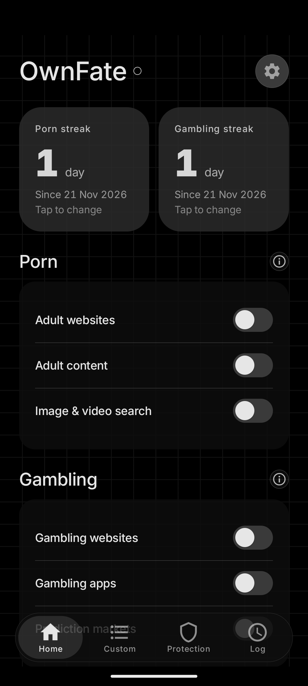
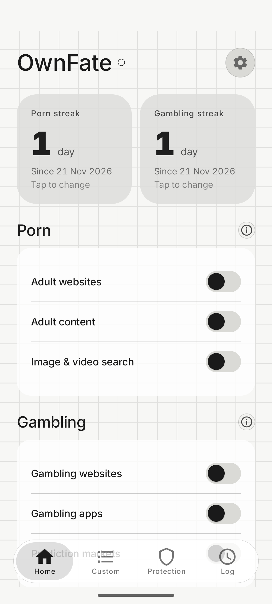
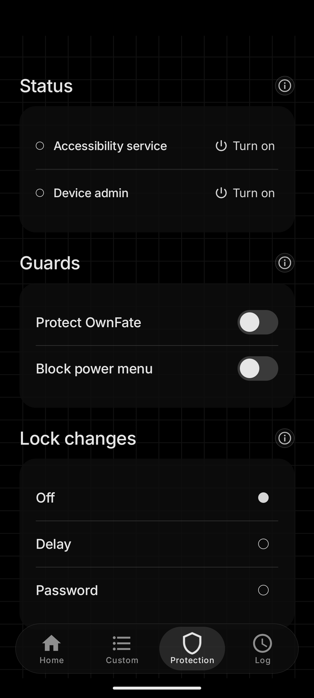

# OwnFate

<a href="https://github.com/Productivityguy/ownfate/blob/main/fastlane/metadata/android/en-US/images/icon.png"></a>


OwnFate is an Android accessibility service that blocks porn and gambling on the phone itself. It
reads what is on screen, folds it, and matches it against a tiered word engine. It also checks the
browser's address bar against three bundled host lists and watches for blocked apps coming to the
front. There is no VPN, no DNS proxy and no network access at all.

- **Package:** `org.ownfate.app`
- **Version:** 1.0.0 (versionCode 1)
- **Minimum Android:** 8.0 (API 26), target API 35
- **Permissions:** none in the manifest; accessibility and device admin are granted by the user
- **Runtime dependencies:** none beyond the Kotlin standard library supplied by the build

## Screenshots

Click on any image to enlarge it.

| | | | |
| --- | --- | --- | --- |
| [](https://github.com/Productivityguy/ownfate/blob/main/fastlane/metadata/android/en-US/images/phoneScreenshots/1-home-dark.png) | [](https://github.com/Productivityguy/ownfate/blob/main/fastlane/metadata/android/en-US/images/phoneScreenshots/2-home-light.png) | [](https://github.com/Productivityguy/ownfate/blob/main/fastlane/metadata/android/en-US/images/phoneScreenshots/3-custom.png) | [](https://github.com/Productivityguy/ownfate/blob/main/fastlane/metadata/android/en-US/images/phoneScreenshots/4-protection.png) |

## Project layout

The source is grouped by responsibility, so a change has one obvious home:

| Path | What lives there |
| --- | --- |
| `MainActivity.kt`, `AdminReceiver.kt` | Activity shell and the optional device-admin receiver |
| `ui/` | Every screen and widget: Home, Custom, Protection, Log, `Brand`, shared components, the floating nav bar, the Home settings sheet, theme pickers and the streak cards |
| `data/` | Preferences (`Store`), the change lock, streaks, host lists and the custom-list editor |
| `data/words/` | The built-in word lists, one file per list, plus the `WordLists` facade |
| `data/apps/` | Bundled gambling and prediction-market app lists |
| `filter/` | `Filter` (the tiered engine) and `Fold` (shared text folding) |
| `guard/` | Accessibility service, page reader, overlay card, off-switch ladder, URL-bar parser, page key/pass, search patterns and the in-app search add-ons |
| `assets/blocklist/` | The bundled host lists, plain text |

### Adding a word

- Adult performers → `data/words/AdultPerformers.kt` (HARD, blocks on sight)
- Adult shows, studios and channels → `data/words/AdultShows.kt` (HARD)
- Explicit phrases → `data/words/AdultKeywords.kt` (HARD)
- Unambiguous stems and brands → `data/words/StrongTerms.kt` (STRONG)
- Explicit words that are unsafe as substrings → `data/words/HardTerms.kt` (HARD)
- Ambiguous words that need context → `data/words/SoftTerms.kt` (SOFT)
- Help-seeking phrases → `data/words/RescuePhrases.kt`
- Ordinary life that should excuse a nearby match → `data/words/AllowPhrases.kt`

`WordLists.kt` is the single facade the engine reads; adding a list means one entry there.

## The four tabs

A floating capsule bar sits above the system gesture area. Its four tabs divide the width evenly
and a soft pill slides behind the active one. Tabs change with a short fade and a small upward
slide: no blur, so the swap feels immediate.

### Home

A circular settings button sits at the top right, beside the **OwnFate** title. It opens a dimmed
card with these choices:

- **Porn streak** — show or hide the porn clean-day counter.
- **Gambling streak** — show or hide the gambling clean-day counter.
- **Theme** — **Dark** (true-black AMOLED) or **Light** (warm off-white with dark ink).
- **Background** — **Grid** (default), **Dots**, or one of the six bundled braille artworks
  (**Samurai**, **Warrior**, **Miku**, **Flower**, **Spiderweb**, **Sword**). The
  picker also carries the **Art colour** swatches.

All of these apply immediately and are not part of the change lock. Hiding a streak only hides the
card: it never resets the counter.

Two clean-day counters normally sit above the switches; either can be hidden from the settings card:

- **Porn streak** and **Gambling streak** count inclusive days from a start date you choose. A
  streak that starts today is day 1. Tap a counter to choose a start date or reset it from today.
  Nothing resets a streak automatically.

The filter switches are all off by default. Turn on what you need:

| Card | Switch | What it covers |
| --- | --- | --- |
| Porn | Adult websites | 79,383 hosts, matched from the browser address bar |
| Porn | Adult words & names | Searches and on-screen text, with the soft-word appeal kept |
| Porn | Image & video search | Image and video result URLs in a browser |
| Gambling | Gambling websites | 6,862 hosts, matched from the browser address bar |
| Gambling | Gambling apps | A bundled starter list plus your own picks |
| Gambling | Prediction markets | Prediction-market hosts and the bundled prediction apps |

The Home screen also shows the accessibility state and an open page pass.

### Custom

**Blocklist** holds **Words / sites** and **Apps**; the **Exclude** section holds **Words / sites**
and **Exclude apps**. Tap the pencil beside a row to open that list in a popup; entries are managed
inside the popup, with **Save** and **Cancel** at the bottom.

- **Words / sites (block):** one word or phrase per line in a fixed scrollable box. Custom words are hard
  blocks with no appeal and are matched with the same folding as the built-in lists. Additions
  apply immediately when you tap Save; removals are weaker and follow the change lock.
- **Apps (block):** always blocked, even when the Gambling apps and Prediction markets switches
  are off. The popup lists installed apps and has a search field. OwnFate, Settings, launchers and
  the system UI are never offered.
- **Words / sites (exclude):** if an excluded word or phrase appears, word blocking is skipped for
  that text.
  A short entry matches a whole word only, so `sex` does not excuse `Sussex`. Site and app blocks
  still apply. Adding an allow word is weaker and follows the lock; removing it is stricter and
  applies immediately.
- **Exclude apps:** excluded apps are not monitored at all. Adding an exclusion follows the lock;
  removing it applies immediately.

Under **Search add-ons**, four switches block the app's own search screen: **Instagram**, **X
(Twitter)**, **Reddit** and **Telegram search**. Each is off by default. The guard recognises
the app's search field by its id, hint or description, and acts only while that field is focused or
holds a real query, so opening the app, a comment box or a private message does not trigger it.
Reddit's `expanded_search_field` and Telegram's `search_section_global` count on their own as well:
the reader walks the visible window once and compares each node's id by its entry, so Reddit's bare
Compose test tag is found too. As soon as the id appears a BACK is sent, before a query is typed.
The guard polls the window in front for every app about every 32 ms, so a search screen is caught
whether or not an accessibility event arrives. When the keyboard is up the first BACK dismisses it
and the second closes the search once the IME is gone; with no keyboard, one BACK is sent and a
second follows only if the search is still there. The pair lands on the app's own feed or chat list.
Every block — a search, a blocked word or site, or a blocked app — then raises the same full-screen
block card. The card appears *after* the BACKs so it cannot swallow them. It is inert for two
seconds, its scrim swallows every other touch, and it never hides itself: it stays until Close, or
Appeal on a soft word match, is pressed. One catch means one BACK pair and one card; there is no
repeat loop and no quiet time in between. Hidden nodes left behind by a screen that has already
closed are ignored, so a normal feed is not read as search. Turning an add-on off is weaker, so it
follows the lock; turning one on applies immediately.

A row shows **Waiting** while a change to that list is still serving out the lock delay.

### Protection

- Accessibility and optional device-admin status.
- **Protect OwnFate:** leaves Settings screens that lead to disabling or uninstalling the app.
- **Block power menu & safe mode:** leaves the power menu when it offers Safe mode.
- A short note under the guards explains the battery cost: the window in front is scanned on a
  fixed poll for every app, with every option checked each time; typed text and addresses are
  checked immediately as well. There is no quiet period after an action or a card.
- **Lock changes:** **Off** (the default), **Delay** or **Password**. Tap Delay to choose hours or
  days; a delay can be up to two days.
- Password set and change. Turning the lock Off resets it to a fresh, unconfigured state.
- Pending changes, each with a cancel action.

### Log

The exact term, the app and the moment the guard stepped in. Page text is hidden by default and
can be revealed per entry. The log is capped and stored locally.

## What is blocked

### Words and names

The keyword engine folds case, punctuation, Unicode lookalikes, leetspeak and stretched spellings
before matching, so `p0rn`, `p.o.r.n`, `ｐｏｒｎ` and `poooorn` all reach the same term. Terms are
tiered:

| Tier | Behaviour |
| --- | --- |
| `STRONG` | Unambiguous stems and brands; block on sight |
| `HARD` | Explicit words, verified performers and adult keywords; block on sight |
| `CUSTOM` | Your own words; block on sight, never gated by the Adult words switch |
| `WEBSITE` | A host on a bundled list; block on sight, no appeal |
| `SOFT` | Ambiguous words and common-name collisions; need a second signal and offer the appeal |
| `RESCUE` | Explicit help intent; excuses a nearby match at any tier |

Explicit rescue phrases win over every tier when they sit next to a match. Generic help context only
softens a nearby `SOFT` match; it never erases an unambiguous `STRONG` stem.

A soft match opens a card with a deliberate way through: the user retypes a sentence and gets a
short-lived page pass. Sites, apps, hard words and custom words never offer that way through.

Every non-soft catch is answered with a checked step back: one BACK, the window is read again after
about 180 ms, and a second BACK follows only if a blocked screen is still in front. Two BACKs are
the whole budget; the phone's Home screen is never used as a page action, so an app that leaves in
one press is not popped twice. A site or word block then shows the Close-only card: inert for two
seconds, touch-swallowing all over, and gone only when Close is pressed. Nothing is put to sleep
after a catch — once the card is closed the always-on scan sees a surviving screen on its next pass
and answers it again. Only the Log is throttled, so a stuck screen cannot fill it with duplicate
lines.

### Sites

Only the browser's address bar and what you type into it are matched against a host list. Page
text is never searched for domains. Each host is checked as itself and then as every parent domain
on a label boundary, so `m.example.com` matches a blocked `example.com`, while `notexample.com`
never does. A bare TLD is never consulted.

The lists are assets inside the APK. They cannot change behind the user's back, and the app
cannot fetch anything.

To refresh the two bundled lists, download the current `alternates/porn/hosts` and
`alternates/gambling/hosts` files from StevenBlack/hosts. Keep only the category extension from each
file, add the bare form of every `www.` entry, and update the constants in `HostList.kt` and the
table above to match. `prediction-market-hosts.txt` is curated separately and is never touched.

### Apps

The bundled gambling list is a curated starter set of real-money sportsbooks, casinos, poker rooms,
betting exchanges and the larger social-casino apps. The Prediction markets switch adds a bundled
list of event-market apps (Kalshi, Polymarket, ProphetX, Novig, Manifold and similar), so one switch
covers the sites and their launcher icons. Event-contract apps such as DraftKings Predictions and
FanDuel Predictions sit with Prediction markets; betting exchanges such as Smarkets stay with
Gambling. Both lists are matched by exact package name on the foreground window. Anything missing
can be added from the installed-app picker; an app on the exclude list is never monitored.

A blocked app shows a full-screen OwnFate card. Close returns Home and is logged. A relaunch inside
the cooldown is sent Home directly, so a relaunch loop cannot flash the card forever.

## The change lock

The lock protects the protection switches on Home and Protection, plus the Custom block/allow
lists. Its rules:

- A **stricter** change applies at once and cancels a pending weaker change for the same setting.
- A **weaker** change becomes pending. The current setting stays active until it lands.
- A pending change can always be cancelled.
- A **correct password** applies a change immediately, even with a delay configured.
- Shortening the delay, switching the delay off or switching the lock off is itself weaker, so it
  waits under the delay that is already configured.
- A password is required before selecting Password. It is stored as a PBKDF2-HMAC-SHA256 hash with
  a random salt. Turning the lock Off wipes the password and resets the delay.
- **There is no recovery.** Clearing the app's data or uninstalling resets everything.

For allow lists, adding is weaker (it permits more) and follows the lock; removing is stricter and
applies immediately. The Home settings menu (streak visibility, theme and background) is a display
preference, so it is deliberately not covered by the lock.

## Tamper protection

OwnFate can add friction, not a lock. Nothing installed as a normal app can survive a force-stop,
safe-mode boot or ADB.

The guard watches only the shells where the off switch actually lives and stays out of the way
elsewhere:

- **Protect OwnFate** covers the app's own uninstall, force-stop, clear-data, accessibility and
  device-admin deactivation screens. With the switch off, none of those screens are inspected.
- App-info, uninstall and deactivation screens must name OwnFate near the top and use the system's
  own destructive wording.
- The accessibility detail page is recognised by OwnFate's service description, its shortcut row or
  a toggle on a page titled with the app label.
- The device-admin deactivation screen is recognised by its activity class plus OwnFate as the page
  heading and a deactivation action. Other apps use the same activity; their pages are left alone.
- Settings search results are never treated as an off switch, even when they show OwnFate next to
  an Uninstall or Deactivate label.
- **Block power menu & safe mode** is separate. The power menu is recognised by its actions, not by
  a "Power menu" title.

The main Accessibility list, the list of device admins, other apps' detail pages, Settings search
and ordinary Settings stay usable.

## Privacy

- No `INTERNET` permission.
- No analytics, crash reporting or telemetry.
- No backup (`android:allowBackup="false"`).
- No third-party runtime dependency.
- Every match happens on the phone. Nothing the app reads can leave it.

The catch log is the only data kept, in one private SharedPreferences file.

## Install

1. Build or install the APK.
2. Open OwnFate and tap the accessibility card, or go to **Settings → Accessibility → OwnFate** and
   turn the service on.
3. Optionally add device admin from the Protection tab. It only adds the deactivation step Android
   puts in front of uninstall; no policies are declared.
4. Configure the switches, your own words and apps, and the change lock.

On Android 13 and later, sideloaded apps may need **Settings → Apps → OwnFate → ⋮ → Allow
restricted settings** before the accessibility service can be enabled.

## Downloads

Stable release APKs are published on the [GitHub Releases page](https://github.com/Productivityguy/ownfate/releases).
Download the latest `ownfate-<version>.apk` and install it directly; there is no store client and no
in-app updater.

The GitHub APK is signed with a dedicated release key, certificate SHA-256
`2b664547cb41132bb2862f170feeb5f9d92c64eb3c5b5d560a5d495f5f3691ac`. F-Droid rebuilds the same
source and signs it with its own key. Android treats those as different apps: when switching between
the GitHub and F-Droid builds, uninstall the other one first. Local settings and streaks do not carry
over.

## Licence

OwnFate is free software licensed under the **GNU General Public License v3.0 or later**
(`GPL-3.0-or-later`). See `LICENSE` for the full text.

Copyright (C) 2026 Productivityguy

Bundled third-party material keeps its own licences:

- Adult and gambling host lists are derived from [StevenBlack/hosts](https://github.com/StevenBlack/hosts)
  (MIT). The prediction-market list is part of OwnFate.
- Inter fonts are licensed under the SIL Open Font License 1.1.

See `THIRD_PARTY_NOTICES.md` for the full notices.

## Build and test

```sh
./gradlew testDebugUnitTest assembleDebug --console=plain --offline
```

The debug APK is written to `app/build/outputs/apk/debug/app-debug.apk`. `./gradlew assembleRelease`
writes:

- `app/build/outputs/apk/release/app-release.apk` when local signing properties point to a dedicated
  release keystore;
- `app/build/outputs/apk/release/app-release-unsigned.apk` when those properties are absent, which is
  the source-build path F-Droid uses before applying its own signature.

The debug key is never used for release builds. Keep `keystore.properties` and the `.jks` file out of
source control and back them up securely; losing the release key means losing the ability to publish
updates under the same signing identity. A signed APK can be checked with
`apksigner verify --print-certs app/build/outputs/apk/release/app-release.apk`.

The unit tests cover the folding engine, the host lists, the URL-bar parser, the page key and pass,
the off-switch rules, the lock's severity, mode exclusivity and hashing, both bundled app lists and
their precedence, the theme colour helpers, the inclusive streak day count, allow-word matching and
the Custom list lock rules.

## Known limits

- Accessibility sees the screen, not the network. A player embedded in an app that never exposes
  text or a URL can be missed. The app lists and custom words are the backstop.
- Host matching is address-bar only. Text-only browsers that expose no address node get keyword
  matching, not site matching.
- The bundled app list cannot be exhaustive. The installed-app picker exists for that reason.
- Power-menu, safe-mode and ADB behaviour varies by manufacturer. The guard is friction, not a
  device-owner policy.
- A forgotten lock password has no recovery inside the app.
